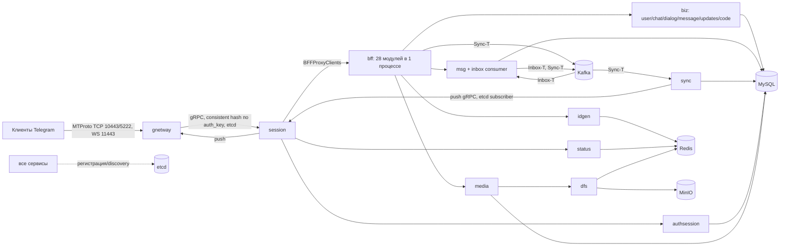

# 03. Архитектура, эксплуатация, сборка, тесты

_Дата: 2026-10-21. Ревизия: `708fb953` (master). Proto: `github.com/teamgram/proto v0.228.0` (layer 228)._

## Вердикт

Стек (MySQL, Redis, etcd, Kafka, MinIO и 11 Go-сервисов) избыточен для ≤100 пользователей, но **проблема надёжности сейчас не в количестве инструментов, а в том, что код и развёртывание не используют их гарантии**:

1. **Kafka не даёт гарантий доставки, ради которых её держат.** Консьюмеры глотают ошибки обработчиков и всё равно фиксируют offset (`session.MarkMessage` безусловно, `_, _ = c.InboxSendUserMessageToInboxV2(r)`). Сбой MySQL/idgen в момент обработки — сообщение получателю потеряно навсегда, без ретрая и DLQ. Брокер один, RF=1, у контейнера нет `restart`.
2. **Redis — источник истины, а не кэш.** Все счётчики `pts`, `seq`, `message_box_id` и `qts` живут только в Redis (`idgen` → `INCRBY`). Восстановления из MySQL нет. Если Redis потеряет данные (AOF `everysec`, `maxmemory` не задан, бэкапов нет), счётчики откатятся. Тогда `messages(user_id, user_message_box_id)` UNIQUE начнёт отвергать вставки (сообщения теряются, ошибка проглатывается), а `pts` у клиентов пойдёт назад.
3. **Нет супервизора процессов.** Все 11 бинарников запускаются фоном в одном контейнере (`runall-docker.sh`), PID 1 — `sh` с `tail -f /dev/null`. Упавший сервис никто не перезапустит, контейнер останется «healthy». `docker stop` не передаёт SIGTERM детям, поэтому graceful shutdown (дренаж session на 30 с) в Docker не срабатывает никогда.
4. **После рестарта `session` реальное время ломается до рестарта `sync`.** В `app/messenger/sync/internal/dao/session_client.go` флаг `unavailable` выставляется при первой ошибке `Unavailable/DeadlineExceeded` и **нигде не сбрасывается** (`Store(false)` в коде нет). При перерегистрации того же адреса в etcd старый объект переиспользуется (`if old, ok := d.sessionServers[v]; ok { sessions[v] = old }`). Пуши молча выбрасываются (`dropping push`), клиенты получают апдейты только через `getDifference`.
5. **Тестов практически нет, CI нет.** Всего 22 тестовых файла и около 62 тест-функций. На msg/sync/inbox/updates/handshake их ноль. `go test ./...` красный (подробности ниже).
6. **Обновление layer зависит от закрытого апстрима.** Генераторы `mtprotoc` и `dalgen3` и исходные `.tl` внутренних сервисов в репозитории отсутствуют. Модуль `teamgram/proto` содержит только сгенерированный код.

**Ответ владельцу («не создаст ли удаление production-инструментов больше проблем?»).** Удалять стоит только то, чьи гарантии код не использует и что стоит ресурсов: ELK-конвейер логов (Elasticsearch + Kibana + Filebeat + go-stash, плюс Kafka как транспорт логов) и Jaeger поверх ES. Ядро (MySQL, Redis, MinIO, etcd, Kafka) **оставить**. Удаление Kafka/etcd сейчас означает переписывание около 100 мест вызова и 6 подписчиков etcd, а надёжности не прибавит. Надёжность прибавят: правильная семантика консьюмеров, персистентность счётчиков, супервизия процессов, бэкапы и алерты. Kafka стоит пересмотреть на этапе 2, после chaos-тестов (вариант: transactional outbox в MySQL).

## Топология

- **Процессы:** 11 (`idgen`, `status`, `authsession`, `dfs`, `media`, `biz`, `msg`, `sync`, `bff`, `session`, `gnetway`). `httpserver` не собирается. Микросервисность частичная: `bff` и `biz` уже агрегируют модули в одном процессе (паттерн `helper.New`, `msg` встраивает `inbox`).
- **Контейнеры (`docker-compose-env.yaml` + `docker-compose.yaml`):** 15. Это `teamgram`, kafka, etcd, redis, mysql, minio, minio-mc, jaeger, node-exporter, prometheus, grafana, elasticsearch (heap 1 ГБ), kibana, filebeat, go-stash. Оценка RAM инфраструктуры: 4–6 ГБ, из них больше половины приходится на ES, Kibana и Kafka JVM. Для 100 пользователей само ядро (Go-сервисы, MySQL, Redis, MinIO) уложится примерно в 1,5–2 ГБ.
- **Discovery:** etcd через go-zero zrpc (`Etcd.Key`). Кроме того, `discov.NewSubscriber` используется напрямую в 6 местах: gnetway (2), session (2), sync и httpserver. Поэтому замена etcd на статические `Endpoints` — правка кода, а не только конфига.
- **Kafka:** топики `Inbox-T` и `Sync-T`, плюс `teamgram-log` для логов. Продюсер `SyncProducer`, `acks=all`, hash-партиционер по ключу: для Sync это `user_id`, для Inbox — peer. Консьюмер: `OffsetNewest`, auto-commit, обработка последовательная внутри партиции, то есть порядок по ключу сохраняется до `sync`. Число мест вызова Kafka-клиентов: около 64 в `app/messenger` и 34 в `app/bff`.
- **Redis:**
  - кэш (go-zero cache) и статус/онлайн с TTL 90 с — допустимо;
  - **счётчики ID — источник истины**;
  - идемпотентность `sendMessage` по `random_id` (TTL 90 с, только при успехе);
  - части загружаемых файлов (`dfs`, hash `file_%d_%d`, TTL 3 ч). Сборка файла идёт через `ReadAll` целиком в память, что опасно для больших видео: и RAM `dfs`, и Redis.
- **MySQL:** основное хранилище. Пулы `Active: 64` × 6–7 пулов (≈400 соединений) превышают дефолтный `max_connections=151` MySQL 8.
- **sync:** работает в режиме «pure push». `AddToPtsQueue` закомментирован, очередь `user_pts_updates` sync не пишет. Восстановление после потерянного пуша целиком зависит от того, как `getDifference` реконструирует состояние из `messages` (см. отчёт 01).

## Режимы отказа

| Событие | Что происходит (по коду) | Последствие |
|---|---|---|
| Ошибка обработчика inbox/sync (MySQL, idgen, biz недоступны, таймаут) | Ошибка логируется и игнорируется, offset коммитится (`marmota/pkg/mq/consumer_group.go`: `MarkMessage` безусловно) | **Потеря** сообщения или апдейта у получателя. Ретрая и DLQ нет |
| Kafka недоступна при `sendMessage` | Исходящее уже записано в MySQL (`SendUserMessageV2`), затем `InboxClient` падает с ошибкой. Идемпотентность кэшируется только при успехе | Двойная запись без атомарности. Отправитель видит ошибку, а при повторе возможен дубль исходящего или сообщение без доставки получателю (проверить в 01) |
| Kafka рестарт / потеря тома | Нет `restart:`, нет healthcheck. RF=1. `OffsetNewest` для новой группы | Ручной подъём. При потере offsets сообщения, накопленные за простой, пропускаются |
| Redis потерял данные (crash без fsync, `FLUSHALL`, OOM-eviction) | Счётчики `pts/seq/box_id` откатываются, восстановления из MySQL нет | Дубли `pts`, отказ UNIQUE на `messages` → тихая потеря сообщений; клиенты в рассинхроне |
| Redis недоступен | idgen, status, dfs, идемпотентность и кэш падают | Отправка сообщений, загрузка файлов и онлайн-статусы не работают |
| etcd недоступен | Уже установленные gRPC-соединения работают (резолвер кэширует), регистрация ретраится раз в 1 с | Сервис, перезапущенный во время простоя etcd, не найдёт зависимости. В целом деградация мягкая |
| Рестарт `session` | Состояние сессий в памяти (очереди, неподтверждённые ответы) теряется. В `sync` залипает `unavailable` | Клиенты переподключаются, но **реальный push не идёт до рестарта sync** |
| Падение любого из 11 процессов в Docker | Супервизора нет, контейнер жив за счёт `tail -f /dev/null`, health-эндпоинтов нет (`DevServer` не включён) | Частичный отказ, невидимый для `docker ps` и `restart: always` |
| `docker stop` / деплой | `ENTRYPOINT` в shell-форме, сигнал до детей не доходит, через 10 с SIGKILL | Graceful shutdown не выполняется ни в одном сервисе. Kafka-консьюмеры не закрываются (`ConsumerGroup.Stop()` пуст) |
| Медленный downstream | В `bff`, `dfs`, `media`, `msg` и в части клиентов `Timeout: 0` (без дедлайна) | Висящие запросы без ограничения по времени |
| Порядок пушей | `sync` раскладывает пуши по 100 горутинам round-robin (`atomic.AddUint64 % RoutineSize`), а не по `user_id` | Пуши одного пользователя переупорядочиваются, клиенту приходится чаще делать `getDifference` |

Дополнительно:
- Уровень логов `debug` во всех `etc2/*.yaml`. Обработчики логируют тела запросов целиком (`inbox.sendUserMessageToInboxV2 - request: %s`), то есть **текст переписки уходит в stdout → Filebeat → Kafka → ES**. Это проблема приватности.
- Tracing `Sampler: 1.0`. При 100 пользователях это нормально, но ES-хранилище для Jaeger избыточно.
- **Приватный RSA-ключ сервера `teamgramd/bin/server_pkcs1.key` закоммичен в git** и запекается в образ. Для продакшена ключ нужно перегенерировать и вынести из репозитория (детали в отчёте 02).
- Образы `ubuntu:latest`, `minio/minio:latest`, `minio/mc:latest` не закреплены по версии. Это невоспроизводимые сборки.
- Миграции БД — набор `migrate-*.sql` без учёта версий. Они применяются только при первой инициализации тома (`docker-entrypoint-initdb.d`), обновлять существующую БД предлагается вручную.

## Сборка / тесты / CI

Окружение: `go1.25.1 darwin/arm64` (Dockerfile при этом на `golang:1.23.0`).

| Команда | Результат |
|---|---|
| `go build ./...` | **OK** (rc=0), около 4 мин на холодном кэше модулей |
| `go vet ./...` | **rc=1**: 52 «unreachable code» в сгенерированных `codec_schema.tl.pb.go` и около 15 ошибок printf-формата (`gnetway/.../handshake.go`, `httpserver/.../handshake.go`, `dfs/.../ffmpegutil`, `dfs/.../examples`) |
| `go test -count=1 ./...` | **rc=1**: 11 пакетов ok, 538 без тестов. Ошибки сборки тестов из-за vet-проверок printf: `gnetway/internal/server/gnet`, `httpserver/internal/dao`, `dfs/internal/ffmpegutil`, `dfs/.../examples/{upload,download}`. Падения: `dfs/internal/imaging/jpeg` (нет `testdata/*.png`), `pkg/goffmpeg/tests` (нужны файлы в `/tmp/ffmpeg`, nil-panic), `bff/users/internal/core` (`TestPatchBotUsernameFromImmutableAddsUsername` — тест не соответствует коду) |

- Тесты: 22 файла и около 62 функций. Покрыты `status`, `session/sess` (auth_state, takeout), PROXY-protocol в gnetway, jpeg/ffmpeg, утилиты `pkg`. **Не покрыты:** отправка и доставка сообщений, inbox/sync, updates/`getDifference`, handshake/шифрование, DAO.
- Интеграционных и conformance-тестов нет. Нагрузочных и chaos-тестов нет.
- **CI отсутствует** (нет `.github/`, нет других пайплайнов).
- Сборка: `build.sh` (Dockerfile) и `Makefile` (ldflags с версией). Это два параллельных способа, и `build.sh` не проставляет версию.

## Кодогенерация и обновление layer

- **TL API клиента** — внешний модуль `github.com/teamgram/proto`, в котором только сгенерированный Go/proto без `.tl`-исходников. Новый layer = апстрим (wubenqi) выпускает `proto vX.Y`, после чего в репозитории правится `go.mod` и добавляются обработчики. Пример — коммит `dffb3136` (layer 228): 8 файлов, +115 строк. Новые методы приходят заглушками `ErrEnterpriseIsBlocked`.
- **Внутренние TL сервисов** (`app/*/<svc>/<svc>.tl.proto`, `codec_schema.tl.pb.go` и пр.) сгенерированы `mtprotoc` из `scheme.tl`. **Ни генератора, ни `.tl` в репозитории нет** (`which mtprotoc dalgen3` → not found). Скрипты `build2.sh` вызывают только `protoc` на уже сгенерированном `.proto` и ссылаются на `$GOPATH/src`.
- **DAO** — `dalgen3` по XML (`internal/dal/tables/*.xml`), обёртка `dalgenall.sh`. Генератор тоже недоступен.
- **Что это значит для ежемесячных обновлений:**
  - пока апстрим публикует `proto`, обновление обходится дёшево (bump плюс заглушки);
  - если апстрим остановится или разойдётся с нашими патчами, нужен свой генератор TL→Go с совместимым кодеком. По оценке это 2–4 недели;
  - новый внутренний RPC или новую таблицу сегодня приходится писать вручную, повторяя стиль сгенерированного кода (proto, codec, `*_grpc.pb.go`, client, service_impl, core handler; DO и DAO для таблицы). На один метод уходит около 0,5–1 дня ручной рутины;
  - **риск:** vendor lock-in на закрытый тулчейн апстрима.

## Рекомендации по инфраструктуре

| Компонент | Решение | Обоснование при ≤100 пользователях |
|---|---|---|
| MySQL | **KEEP** | Единственный долговременный источник истины. Добавить: бэкапы (xtrabackup или `mysqldump` плюс binlog) с проверкой восстановления, инструмент миграций с версиями (goose/atlas), согласовать пулы (`Active` 8–16) или `max_connections` |
| Redis | **KEEP, но как хранилище** | Сейчас хранит счётчики ID. Обязательно: AOF `appendfsync always` (или `everysec` с осознанным риском) плюс RDB-бэкап, `maxmemory-policy noeviction`. **Восстановление счётчиков idgen из MySQL при старте** (max по `messages`/`pts`). Позже — перенести счётчики в MySQL (нагрузка ничтожная) |
| Kafka | **KEEP сейчас, FIX семантику; пересмотреть на этапе 2** | Удаление затронет около 100 мест вызова и при этом не устранит главную проблему (двойную запись MySQL→Kafka). Сначала: не коммитить offset при ошибке, ретрай с backoff, DLQ, идемпотентные обработчики, `restart`/healthcheck, ключ топиков явно. Альтернатива на этапе 2 — transactional outbox в MySQL с воркером в процессе `msg`: даёт атомарность и убирает JVM |
| etcd | **KEEP** | Около 50 МБ RAM, не хранит пользовательских данных, отказ мягкий. Удаление требует правки 6 подписчиков. Добавить `restart`, healthcheck |
| MinIO | **KEEP** | S3-совместимое хранилище файлов. Закрепить версию, бэкап (`mc mirror`), не публиковать 9000/9001 наружу |
| FFmpeg | **KEEP** | Нужен `dfs` для превью и транскодинга. Закрепить версию в образе |
| Микросервисный сплит (11 процессов) | **KEEP код, ИЗМЕНИТЬ развёртывание** | Один контейнер без супервизора — худший вариант. Сделать по сервису на compose-service с `restart: unless-stopped`, healthcheck (`DevServer` go-zero), `stop_grace_period`, exec-форму ENTRYPOINT. Слияние в один бинарник возможно (паттерн `helper.New`), но не сейчас |
| Prometheus + Grafana + node-exporter | **KEEP** | Дёшево. Добавить Alertmanager в compose и алерты: процесс недоступен, лаг консьюмера, ошибки обработчиков, Redis/MySQL. Включить метрики в `sync` (сейчас закомментированы) |
| Jaeger | **SIMPLIFY** | Оставить трейсинг, но хранилище — Badger/memory или Tempo вместо ES |
| Elasticsearch + Kibana + Filebeat + go-stash (+ Kafka для логов) | **REMOVE / заменить** | Около 3 ГБ RAM и 4 контейнера ради логов 11 процессов. Заменить на Loki + Promtail/Alloy (в ту же Grafana) или journald/docker-логи с ротацией. Уровень логов `info`, тела сообщений не логировать |
| minio-mc init-контейнер | SIMPLIFY | Оставить разовым шагом или перенести создание бакетов в `dfs` |

**Почему это не «удаление ради простоты».** Каждый KEEP-компонент либо хранит данные (MySQL, Redis, MinIO), либо стоит копейки и вшит в код (etcd), либо станет полезным после исправления семантики (Kafka). REMOVE касается только того, что не даёт гарантий доставки и хранения сообщений, но потребляет больше половины ресурсов и добавляет точки отказа (ES OOM, переполнение диска).

## Оценка объёма

| Работа | Оценка |
|---|---|
| Развёртывание: compose по сервисам, restart, healthcheck, exec-entrypoint, закрепление версий, вынос секретов и RSA-ключа | 2–3 дня |
| Бэкапы MySQL/Redis/MinIO плюс проверенный restore-runbook | 2–3 дня |
| Семантика Kafka-консьюмеров (ретраи, DLQ, не коммитить при ошибке, Stop/Close), правка в форке `marmota/pkg/mq` или своём пакете | 3–5 дней |
| Восстановление счётчиков idgen из MySQL и персистентность Redis | 2–3 дня |
| Фикс залипающего `unavailable` в sync, порядок пушей по `user_id` | 1 день |
| Таймауты RPC (убрать `Timeout: 0`), пулы MySQL, уровень логов, без тел сообщений | 1 день |
| Замена ELK на Loki, Alertmanager плюс базовые алерты, метрики sync | 2–3 дня |
| CI (build, `vet` без шума codegen, test), починка 3 красных тестов | 1–2 дня |
| Интеграционный тест-контур (docker-compose в CI, сценарии send/receive/getDifference/рестарты) | 1–2 недели |
| Инструмент миграций и baseline схемы | 2 дня |
| (Этап 2, опционально) outbox в MySQL вместо Kafka | 1–2 недели |
| (Риск) собственный генератор TL при остановке апстрима | 2–4 недели |

Итого фундамент эксплуатации (без опциональных пунктов): **около 4–6 недель** одного инженера.
